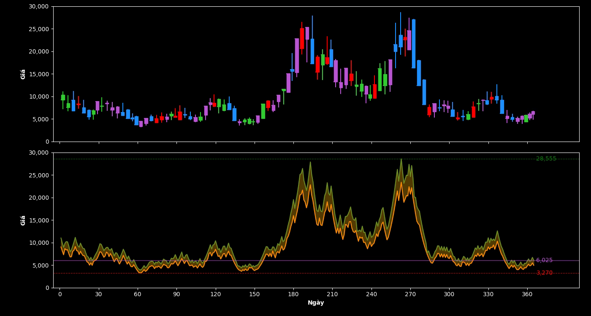

# Trực quan hóa giá cổ phiếu ABC-15

Dự án giữa kỳ sử dụng **Python** để xử lý dữ liệu giá cổ phiếu ABC-15, tạo video diễn tiến giá bằng **Matplotlib và FFmpeg**, sau đó phát video trên ứng dụng web **FastAPI**.

Dữ liệu gồm **365 ngày**, mỗi ngày có **7 giá trị**, tương ứng **2.555 quan sát**. [`video.py`](video.py) dựng video, còn [`ket_qua/xuat_ket_qua.py`](ket_qua/xuat_ket_qua.py) thực hiện phân tích và xuất kết quả cho 6 câu hỏi.



> Hình trên là ảnh poster có sẵn của trang web. Video phát từ `static/video/abc15.mp4`; quá trình dựng video chạy riêng bằng `video.py`.

## 1. Chức năng

- Đọc và kiểm tra dữ liệu từ tệp CSV.
- Tính giá thấp nhất, cao nhất, đóng cửa và tham chiếu của từng ngày.
- Trực quan hóa phân bố giá theo nhóm tối đa 4 ngày bằng hộp tứ phân vị.
- Hiển thị đường giá đóng cửa, vùng biến động trong ngày và các mức cực trị đóng cửa đã xuất hiện.
- Đổi màu biểu đồ theo quan hệ giữa giá đóng cửa và giá tham chiếu.
- Xuất video MP4 và phát trên trình duyệt với các nút điều khiển HTML5.
- Thống kê giá theo tháng, quý và xác định các ngày chạm sàn, chạm trần, bằng tham chiếu hoặc vượt biên.
- So sánh phân bố giá giữa hai nửa năm, phân tích xu hướng năm và giải thích quy tắc màu.
- Xuất bảng CSV, biểu đồ PNG và phần diễn giải TXT vào `ket_qua/ket_qua_6_cau/`.

## 2. Công nghệ sử dụng

| Công nghệ | Vai trò |
| --- | --- |
| Python | Ngôn ngữ xử lý dữ liệu và xây dựng ứng dụng |
| NumPy | Tính toán trên mảng, tứ phân vị và so sánh số thực |
| pandas | Đọc CSV, gom nhóm tháng/quý và tính trung bình trượt |
| Matplotlib | Vẽ và cập nhật các khung hình |
| FFmpeg | Mã hóa video MP4 bằng H.264 |
| FastAPI, Uvicorn | Ứng dụng web và máy chủ chạy ứng dụng |
| Jinja2 | Kết xuất giao diện HTML |
| HTML5, CSS | Trình phát video và bố cục trang web |

## 3. Cấu trúc thư mục

Các tệp và thư mục chính:

```text
web-giuaki-kiet/
├── data/
│   └── abc-15.csv                 # Dữ liệu đầu vào 365 × 7
├── ket_qua/
│   ├── xuat_ket_qua.py            # Phân tích và xuất kết quả 6 câu hỏi
│   └── ket_qua_6_cau/
│       ├── cau_1_theo_thang.csv
│       ├── cau_1_gia_trung_binh.png
│       ├── cau_1_boxplot.png
│       ├── cau_2_theo_quy.csv
│       ├── cau_3_ngay_bat_thuong.csv
│       ├── cau_4_hai_nua_nam.csv
│       ├── cau_4_phan_bo_gia.png
│       ├── cau_5_xu_huong_nam.png
│       └── cau_6.txt
├── static/
│   ├── css/style.css
│   ├── img/bieu_do_day_du.png      # Ảnh poster
│   └── video/abc15.mp4             # Video được trang web phát
├── templates/
│   └── index.html                 # Giao diện chính
├── main.py                        # Ứng dụng FastAPI
├── video.py                       # Xử lý dữ liệu và tạo video
├── requirements.txt
├── render.yaml                    # Cấu hình triển khai Render
└── README.md
```

Hai thư mục phục vụ việc dựng video:

- `tools/`: nơi đặt FFmpeg trên Windows; thư mục này bị bỏ qua bởi `.gitignore`, cần tự chuẩn bị.
- `output/`: được chương trình tạo khi xuất video theo đường dẫn mặc định.

Sơ đồ trên thể hiện các tệp kết quả đang có trong kho mã nguồn. Khi chạy đầy đủ `xuat_ket_qua.py`, chương trình còn tạo `cau_1.txt` đến `cau_5.txt` và cập nhật các kết quả còn lại. Hướng dẫn chạy nằm ở mục 8.

## 4. Dữ liệu đầu vào

Tệp [`data/abc-15.csv`](data/abc-15.csv) không có hàng tiêu đề. Mỗi hàng chứa 7 mức giá trong một ngày.

Chương trình quy ước:

| Đại lượng | Cách xác định |
| --- | --- |
| Giá thấp nhất | Giá trị nhỏ nhất trên mỗi hàng |
| Giá cao nhất | Giá trị lớn nhất trên mỗi hàng |
| Giá đóng cửa | Giá trị ở cột cuối cùng |
| Giá tham chiếu ngày đầu | 10.000 |
| Giá tham chiếu các ngày sau | Giá đóng cửa của ngày liền trước |

Khi chạy trực tiếp `python video.py`, chương trình yêu cầu ma trận có đúng kích thước `(365, 7)`, mọi giá trị đều hữu hạn và lớn hơn 0. Các kiểm tra này nằm trong khối `__main__`.

CSV không chứa cột ngày tháng. Trục ngang của video sử dụng chỉ số từ **0 đến 364**, dù nhãn trục trong mã là `Date`. Chương trình `xuat_ket_qua.py` dùng lịch không nhuận 2025 để gán tháng/quý cho 365 hàng, không xác nhận năm thực tế của dữ liệu.

Phần thống kê sử dụng cả 7 giá trị mỗi ngày và **độ lệch chuẩn quần thể (`ddof=0`)**. Riêng biểu đồ xu hướng năm sử dụng giá đóng cửa và trung bình trượt 30 ngày của chuỗi đóng cửa.

## 5. Cài đặt và chạy web

### Yêu cầu

- Python 3, có `pip` và mô-đun `venv`.
- Git nếu tải mã nguồn bằng lệnh `git clone`; có thể tải ZIP từ GitHub thay thế.
- FFmpeg khi cần tạo lại video. Chạy web với MP4 đã có sẵn hoặc xuất các kết quả thống kê chỉ cần các thư viện Python.

### Tải mã nguồn

```bash
git clone https://github.com/Tommyhyhyhy/web-giuaki-kiet.git
cd web-giuaki-kiet
```

Chạy các lệnh tiếp theo từ thư mục gốc dự án, nơi chứa `main.py` và `requirements.txt`.

### Windows PowerShell

```powershell
python -m venv .venv
.\.venv\Scripts\python.exe -m pip install -r requirements.txt
.\.venv\Scripts\python.exe -m uvicorn main:app --reload
```

### macOS hoặc Linux

```bash
python3 -m venv .venv
.venv/bin/python -m pip install -r requirements.txt
.venv/bin/python -m uvicorn main:app --reload
```

Mở **[http://127.0.0.1:8000](http://127.0.0.1:8000)** để xem ứng dụng. Nhấn `Ctrl+C` trong terminal để dừng máy chủ.

Các lệnh trên gọi trực tiếp Python của môi trường ảo nên không cần kích hoạt môi trường bằng một lệnh riêng.

### Các đường dẫn của ứng dụng

| Đường dẫn | Chức năng |
| --- | --- |
| `/` | Giao diện phát video |
| `/health` | Trả về `{"status":"ok"}` khi ứng dụng xử lý được yêu cầu |
| `/static/video/abc15.mp4` | Tệp video được trình duyệt tải |

`/health` kiểm tra khả năng đáp ứng của ứng dụng, chưa kiểm tra sự tồn tại hoặc tính hợp lệ của video.

## 6. Tạo lại video

### Bước 1: chuẩn bị FFmpeg

Tải FFmpeg từ [trang tải chính thức](https://ffmpeg.org/download.html), chọn bản phù hợp với hệ điều hành.

**Trên Windows**, tạo thư mục `tools` tại thư mục gốc dự án và đặt chương trình tại:

```text
tools/ffmpeg.exe
```

Giữ các thư viện đi kèm nếu bản FFmpeg sử dụng thư viện động. Có thể kiểm tra bằng PowerShell:

```powershell
.\tools\ffmpeg.exe -version
```

Trong mã hiện tại, `video.py` ưu tiên `tools/ffmpeg.exe`. Nếu không tìm thấy, chương trình chuyển sang đường dẫn cố định `D:/gki/tools/ffmpeg.exe`. Cần đặt FFmpeg đúng vị trí hoặc sửa cấu hình này cho máy đang sử dụng.

**Trên macOS hoặc Linux**, cài FFmpeg để lệnh `ffmpeg -version` hoạt động. Sau đó thêm `from shutil import which` ở đầu `video.py` và thay đoạn cấu hình đường dẫn FFmpeg trong `tao_video()` bằng:

```python
ffmpeg = which("ffmpeg")
if ffmpeg is None:
    raise FileNotFoundError("Không tìm thấy FFmpeg trong PATH.")
plt.rcParams["animation.ffmpeg_path"] = ffmpeg
```

Đây là thay đổi cần thực hiện khi dùng FFmpeg từ `PATH`; mã gốc đang sử dụng đường dẫn dành cho Windows.

### Bước 2: chạy chương trình dựng video

Windows PowerShell:

```powershell
.\.venv\Scripts\python.exe video.py
```

macOS hoặc Linux, sau khi sửa đường dẫn FFmpeg:

```bash
.venv/bin/python video.py
```

Tệp đầu ra mặc định:

```text
output/abc15_code_gon.mp4
```

Chương trình in tiến độ sau mỗi 60 ngày. Quá trình mã hóa có thể mất thời gian tùy máy.

### Bước 3: cập nhật video cho trang web

Trang web phát `static/video/abc15.mp4`, trong khi chương trình mặc định xuất sang `output/abc15_code_gon.mp4`. Sau khi dựng xong, sao chép video mới đến đường dẫn web sử dụng.

Windows PowerShell:

```powershell
Copy-Item -LiteralPath "output/abc15_code_gon.mp4" -Destination "static/video/abc15.mp4" -Force
```

macOS hoặc Linux:

```bash
cp output/abc15_code_gon.mp4 static/video/abc15.mp4
```

Lệnh trên thay thế video đang được web sử dụng. Sau đó tải lại trang; nếu trình duyệt vẫn hiển thị video cũ, thực hiện tải lại bỏ qua bộ nhớ đệm.

Một cách khác là sửa lời gọi cuối cùng trong `video.py` để xuất trực tiếp vào vị trí phục vụ web:

```python
tao_video(gia, THU_MUC / "static/video/abc15.mp4")
```

## 7. Giải thích phần chính trong `video.py`

### Hàm `mau_gia(gia, tham_chieu)`

Hàm trả về màu của giá đóng cửa hiện tại theo mức tham chiếu:

| Trường hợp | Màu trong video |
| --- | --- |
| Bằng 90% tham chiếu, tức chạm sàn | Xanh da trời (`deepskyblue`) |
| Bằng 110% tham chiếu, tức chạm trần | Tím hồng (`magenta`) |
| Bằng tham chiếu | Vàng (`yellow`) |
| Cao hơn tham chiếu, sau khi loại trường hợp chạm trần | Xanh lá (`green`) |
| Thấp hơn tham chiếu, sau khi loại trường hợp chạm sàn | Đỏ (`red`) |

Các phép kiểm tra sàn, trần và bằng tham chiếu sử dụng `np.isclose` với `rtol=0`, `atol=1e-5` để xử lý sai số số thực. Biên ±10% là quy ước đang dùng trong dự án.

### Hàm `tao_video(gia, tep_video=...)`

Hàm thực hiện các bước:

1. Cấu hình Matplotlib và đường dẫn FFmpeg.
2. Tính các mảng giá theo ngày, đồng thời tạo hai trục biểu đồ.
3. Khởi tạo các hộp, râu, đường giá và nhãn.
4. Duyệt lần lượt các ngày, cập nhật nội dung rồi ghi khung hình.
5. Kết thúc mã hóa, đóng biểu đồ và thông báo đường dẫn MP4.

**Biểu đồ trên: hộp tứ phân vị theo nhóm tối đa 4 ngày**

- Mỗi ngày bổ sung 7 quan sát; nhóm đủ 4 ngày có 28 quan sát.
- Thân hộp kéo từ Q1 đến Q3, vạch trắng biểu diễn trung vị.
- Râu hộp kéo từ giá nhỏ nhất đến lớn nhất của dữ liệu đã có trong nhóm.
- Khi thêm ngày, chương trình tính lại tứ phân vị và tăng độ rộng của hộp.
- Màu hộp phụ thuộc vào giá đóng cửa của ngày đang xét so với tham chiếu của ngày đó.
- Với 365 ngày, có 92 nhóm: 91 nhóm đủ 4 ngày và một nhóm cuối có 1 ngày.

Mặc dù biến trong mã dùng tên `nen`, cấu trúc này là **hộp tứ phân vị**, không phải nến OHLC. Quy tắc râu của video cũng khác quy tắc 1,5 IQR của boxplot tháng do `xuat_ket_qua.py` tạo.

**Biểu đồ dưới: diễn tiến giá theo ngày**

- Đường giá đóng cửa lấy từ cột cuối của CSV.
- Hai đường biên và vùng tô biểu diễn khoảng giá thấp nhất đến cao nhất của từng ngày đã xuất hiện.
- Các nhãn `min` và `max` theo dõi cực trị tích lũy của **giá đóng cửa**, không phải cực trị của tất cả 2.555 quan sát.
- Nhãn giá hiện tại dịch chuyển theo ngày đang hiển thị.
- Lệnh `set_color(mau)` đổi màu **toàn bộ đường đóng cửa đang hiển thị** theo ngày hiện tại; mã chưa lưu màu riêng cho từng đoạn lịch sử.

Vùng tô giữa hai đường biên là khoảng biến động giá trong ngày, không phải khoảng tin cậy thống kê.

### Thông số xuất video

| Thuộc tính | Cấu hình |
| --- | --- |
| Định dạng | MP4 |
| Bộ mã hóa | H.264, qua `libx264` |
| Kích thước khung hình | 1660 × 986 pixel |
| Tốc độ đầu ra | 30 fps |
| Thời lượng cấu hình | `5663 / 30` giây, khoảng 3 phút 08,77 giây |
| Chất lượng mã hóa | `CRF 18`, preset `fast` |
| Định dạng điểm ảnh | `yuv420p` |
| Tùy chọn phục vụ phát trên web | `+faststart` |

Chương trình gọi `grab_frame()` **367 lần**: một khung đầu, 365 khung theo ngày và một lần ghi lại khung cuối. Tốc độ gửi hình vào bộ mã hóa khoảng 1,944 hình/giây. FFmpeg chuyển thành đầu ra 30 fps bằng cách lặp khung hình; bước này không tạo thêm dữ liệu giá.

## 8. Phân tích và xuất kết quả 6 câu hỏi

Chương trình [`ket_qua/xuat_ket_qua.py`](ket_qua/xuat_ket_qua.py) đọc dữ liệu, tính thống kê, lưu biểu đồ và xuất phần diễn giải cho từng câu. Chương trình dùng Matplotlib với backend `Agg`, nên lưu ảnh trực tiếp mà không mở cửa sổ biểu đồ.

### Sửa đường dẫn CSV trước khi chạy

Ở phiên bản `766e4e1`, chương trình nằm trong `ket_qua/`, nhưng dòng đọc dữ liệu đang là:

```python
gia = pd.read_csv(thu_muc / 'data/abc-15.csv', header=None).to_numpy(dtype=float)
```

Vì `thu_muc` là thư mục chứa chương trình, dòng này tìm `ket_qua/data/abc-15.csv`, trong khi dữ liệu thật nằm ở `data/abc-15.csv` tại gốc dự án. **Thay dòng trên bằng:**

```python
gia = pd.read_csv(thu_muc.parent / 'data/abc-15.csv', header=None).to_numpy(dtype=float)
```

Giữ nguyên `thu_muc = Path(__file__).resolve().parent` và `ket_qua = thu_muc / 'ket_qua_6_cau'` để kết quả vẫn được ghi vào đúng thư mục. Chỉ đổi thư mục làm việc trong terminal sẽ không sửa được lỗi này, vì đường dẫn được tính từ vị trí tệp Python.

### Chạy chương trình

Sau khi cài `requirements.txt` và sửa dòng đọc CSV như trên, chạy từ thư mục gốc dự án.

Windows PowerShell:

```powershell
.\.venv\Scripts\python.exe ket_qua/xuat_ket_qua.py
```

macOS hoặc Linux:

```bash
.venv/bin/python ket_qua/xuat_ket_qua.py
```

Chương trình in kết quả ra terminal và lưu vào:

```text
ket_qua/ket_qua_6_cau/
```

Mỗi lần chạy sẽ ghi lại các tệp cùng tên. Bước phân tích này không cần FFmpeg và không tạo lại video MP4.

### Nội dung và tệp đầu ra

Các tên tệp trong bảng dưới đều nằm trong `ket_qua/ket_qua_6_cau/`.

| Câu | Nội dung phân tích | Tệp bảng và biểu đồ |
| --- | --- | --- |
| 1 | Trung bình, độ lệch chuẩn, cực trị, biên độ và phân bố giá theo tháng | [`cau_1_theo_thang.csv`](ket_qua/ket_qua_6_cau/cau_1_theo_thang.csv), [`cau_1_gia_trung_binh.png`](ket_qua/ket_qua_6_cau/cau_1_gia_trung_binh.png), [`cau_1_boxplot.png`](ket_qua/ket_qua_6_cau/cau_1_boxplot.png) |
| 2 | Thống kê quý, hệ số biến thiên CV và thay đổi giá đầu–cuối quý | [`cau_2_theo_quy.csv`](ket_qua/ket_qua_6_cau/cau_2_theo_quy.csv) |
| 3 | Liệt kê ngày chạm sàn, chạm trần, bằng tham chiếu hoặc vượt biên | [`cau_3_ngay_bat_thuong.csv`](ket_qua/ket_qua_6_cau/cau_3_ngay_bat_thuong.csv) |
| 4 | So sánh phân bố giá giữa hai quý đầu và hai quý cuối | [`cau_4_hai_nua_nam.csv`](ket_qua/ket_qua_6_cau/cau_4_hai_nua_nam.csv), [`cau_4_phan_bo_gia.png`](ket_qua/ket_qua_6_cau/cau_4_phan_bo_gia.png) |
| 5 | Xu hướng năm, giá cực trị, biên độ năm và biên độ trong ngày | [`cau_5_xu_huong_nam.png`](ket_qua/ket_qua_6_cau/cau_5_xu_huong_nam.png) |
| 6 | Tìm ví dụ giá giảm giữa hai quan sát liên tiếp nhưng vẫn trên tham chiếu | Phần giải thích trong [`cau_6.txt`](ket_qua/ket_qua_6_cau/cau_6.txt) |

Ngoài các tệp trong bảng, chương trình ghi phần diễn giải cho cả 6 câu vào `cau_1.txt` đến `cau_6.txt`. Một lần chạy thành công tạo tổng cộng **14 tệp: 4 CSV, 4 PNG và 6 TXT**. CSV và TXT sử dụng mã hóa `utf-8-sig`.

### Một số quy ước cần lưu ý

- **Câu 1:** boxplot tháng dùng râu theo quy tắc 1,5 IQR; các điểm ngoài râu được hiển thị riêng. Bảng tháng gồm trung bình, độ lệch chuẩn, thấp nhất, cao nhất và biên độ.
- **Câu 2:** `CV = độ lệch chuẩn / trung bình × 100%`. Thay đổi đầu–cuối quý so sánh giá đầu tiên của ngày đầu quý với giá đóng cửa ngày cuối quý.
- **Câu 3:** bảng chỉ giữ các ngày có ít nhất một sự kiện. Một ngày có thể vừa chạm sàn vừa chạm trần; chạm biên không tự động là lỗi dữ liệu.
- **Câu 4:** hai histogram dùng chung 25 khoảng giá và mật độ để so sánh các nhóm có số quan sát khác nhau.
- **Câu 5:** trung bình trượt 30 ngày chỉ xuất hiện trong biểu đồ phân tích năm. `video.py` chưa vẽ đường trung bình này.
- **Câu 6:** ví dụ xét hai quan sát liên tiếp trong cùng ngày. Giá có thể giảm so với quan sát trước mà vẫn cao hơn tham chiếu. Đây là cách giải thích quy tắc màu; trong video hiện tại, màu của toàn bộ đường đóng cửa vẫn được cập nhật theo ngày đang xét.

Trang web hiện chỉ phát video. Các bảng, ảnh và phần giải thích trong `ket_qua/ket_qua_6_cau/` chưa được đưa vào giao diện web.

## 9. Triển khai với cấu hình Render

Tệp [`render.yaml`](render.yaml) khai báo một dịch vụ web Python với các lệnh:

```text
Build command: pip install -r requirements.txt
Start command: uvicorn main:app --host 0.0.0.0 --port $PORT
```

Trước khi triển khai, cần bảo đảm `static/video/abc15.mp4` đã có trong phiên bản mã nguồn được đưa lên máy chủ.

Cấu hình hiện tại chỉ cài thư viện và khởi động web, **không chạy `video.py` trong bước build**. Tệp cấu hình đặt `autoDeployTrigger: "off"`, do đó cần chủ động thực hiện lần triển khai khi cập nhật dự án.

## 10. Một số lỗi thường gặp

| Hiện tượng | Cách kiểm tra và xử lý |
| --- | --- |
| `ModuleNotFoundError` | Cài `requirements.txt` bằng đúng Python của môi trường ảo và dùng chính Python đó để chạy chương trình. |
| Không tìm thấy FFmpeg | Kiểm tra `tools/ffmpeg.exe` trên Windows hoặc sửa cấu hình để dùng FFmpeg trong `PATH`. |
| `FileNotFoundError` khi chạy `xuat_ket_qua.py` | Sửa đường dẫn đọc CSV thành `thu_muc.parent / 'data/abc-15.csv'` như mục 8. |
| Báo dữ liệu không hợp lệ | Kiểm tra CSV có đúng 365 hàng, 7 cột, không có tiêu đề, giá trị thiếu, vô hạn hoặc không dương. |
| Trang web mở được nhưng video không phát | Kiểm tra tệp `static/video/abc15.mp4`, mở trực tiếp đường dẫn video và xác nhận video đã dựng thành công. |
| Video mới chưa xuất hiện trên web | Sao chép tệp từ `output/` sang `static/video/abc15.mp4`, sau đó tải lại trang bỏ qua bộ nhớ đệm. |
| Không tải được giao diện khi chạy máy chủ | Chạy lệnh Uvicorn tại thư mục chứa `main.py`, giữ nguyên `templates/` và `static/`. |
| Chưa thấy `cau_1.txt` đến `cau_5.txt` sau khi tải mã nguồn | Đây là các tệp chương trình sinh ra; sửa đường dẫn CSV và chạy `ket_qua/xuat_ket_qua.py` để tạo đầy đủ. |

## 11. Giới hạn và hướng phát triển

- Dữ liệu hiện cố định ở 365 × 7; có thể tham số hóa số ngày và số quan sát.
- Đường dẫn FFmpeg đang phụ thuộc Windows; có thể chuyển sang cấu hình theo môi trường.
- Đường dẫn video xuất ra và video được web phục vụ đang khác nhau; có thể dùng một cấu hình chung.
- Backend truyền biến `video_available` cho template, nhưng giao diện hiện chưa sử dụng biến này để thông báo khi thiếu video.
- Chương trình `xuat_ket_qua.py` đã có khả năng tái tạo kết quả, nhưng cần sửa đường dẫn CSV như mục 8 trước khi chạy từ cấu trúc kho mã nguồn hiện tại.
- Có thể bổ sung các bảng và biểu đồ phân tích vào giao diện web.
- Có thể bổ sung chọn dữ liệu đầu vào, tùy chỉnh thời lượng và hiển thị tiến độ dựng video.

Phạm vi hiện tại là trực quan hóa dữ liệu đã có. Dự án chưa tích hợp nguồn giá trực tiếp hoặc chức năng dự báo.

## 12. Tác giả và mã nguồn

- **Sinh viên:** Huỳnh Tuấn Kiệt.
- **Mã nguồn:** [Tommyhyhyhy/web-giuaki-kiet](https://github.com/Tommyhyhyhy/web-giuaki-kiet).

README mô tả cấu trúc và hành vi của phiên bản mã nguồn [`766e4e1`](https://github.com/Tommyhyhyhy/web-giuaki-kiet/commit/766e4e1415afb7a3c09635e90a385bb38594c17d).
